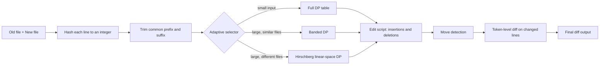
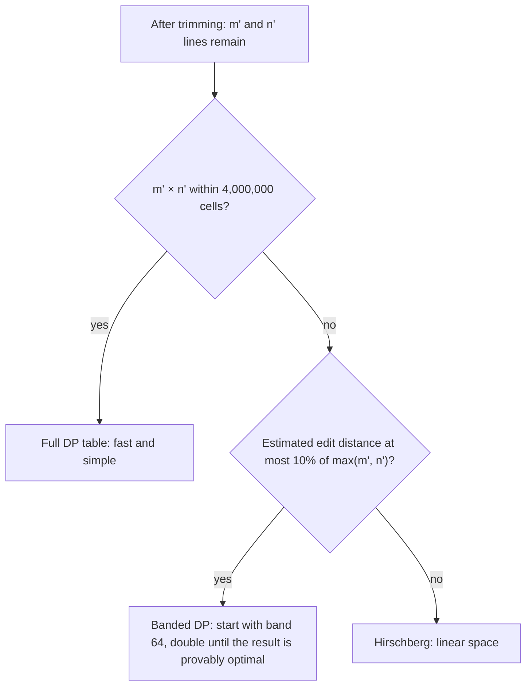
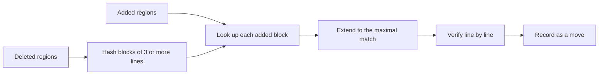

# Adaptive LCS Diff

**A memory-aware, move-aware diff engine for source code, built on dynamic programming.**

> DAA (Design and Analysis of Algorithms, CSE 204) research project · SRM University AP
> Status: **Phase 1 complete (problem formulation and proposed solution). Implementation and evaluation are in progress.**

---

## Overview

`git diff` answers a simple question: *what changed between two versions of a file?* Under the hood this is a classic dynamic programming problem, the **Longest Common Subsequence (LCS)** of the two files' lines. Every line outside the LCS is an insertion or a deletion.

The textbook LCS solution is easy to teach but expensive in practice. For two files of 10,000 lines, the DP table has 10^8 cells, which is about 400 MB at 4 bytes per cell. This project builds a diff engine that keeps the exactness of LCS while fixing the memory problem and adding features that a plain diff does not offer.

## Problem Statement

**Assigned problem:** Mini Git Diff (Dynamic Programming). Build your own `git diff` using LCS dynamic programming and compare its time and memory on real code files.

**Research question:** Can an adaptive LCS engine produce smaller, more readable edit scripts than classic diff, while using far less memory, on real code?

## What Makes This Different

A plain re-implementation of `git diff` adds nothing new. This project adds three measurable features:

| Feature | Standard diff | Adaptive LCS Diff |
|---|---|---|
| Memory | Full O(mn) table (textbook LCS) | Linear-space Hirschberg DP |
| Moved code | Shown as delete + add | Detected and stored as a *move* in the edit script |
| Granularity | Whole lines, or regex word split | Code-aware tokens inside changed lines |
| Algorithm choice | User picks a flag | Chosen automatically per file pair |

> Note: git already has partial versions of some of these (for example `--color-moved` and `--word-diff`). The contribution here is one exact engine that combines them, plus a **measured comparison** against git's own algorithms.

## How It Works

### Pipeline

1. **Hash lines.** Each line becomes an integer, so comparing two lines costs O(1).
2. **Trim ends.** The identical head and tail of both files are removed. In real commits this is usually most of the file.
3. **Select.** A small selector picks the cheapest engine that still returns an optimal answer.
4. **Diff.** The chosen engine computes the LCS and the edit script.
5. **Post-process.** Relocated blocks are reported as moves, and changed lines get a token-level diff.

### The adaptive selector

The thresholds (4 million cells, 10%, starting band 64) are starting values. They will be tuned from experiments in Phase 2. All three engines return an optimal answer, so the selector changes the cost, never the result.

### Move detection

Verification keeps hash collisions from creating a false move. Larger blocks are matched first, and each line is used at most once.

## Algorithms and Complexity

| Method | Time | Space | Role |
|---|---|---|---|
| Classic LCS table (CLRS) | O(mn) | O(mn) | Baseline |
| Myers, as in git diff | O(ND) | O(N) | Baseline |
| Hirschberg linear-space LCS | O(mn) | O(min(m, n)) | This project |
| Banded DP (Ukkonen) | O(kn) | O(kn) | This project |
| Adaptive selector | O(m + n) extra | O(1) extra | This project |
| Hash-based move detection | O(d) expected | O(d) | This project |

*m, n: lines per file · N = m + n · D: edit distance · k: band width · d: changed lines.*

## A Small Worked Example

Treat each letter as one line. File A = `A B C B D A B`, file B = `B D C A B A`.

|   | – | B | D | C | A | B | A |
|---|---|---|---|---|---|---|---|
| – | 0 | 0 | 0 | 0 | 0 | 0 | 0 |
| A | 0 | 0 | 0 | 0 | 1 | 1 | 1 |
| B | 0 | 1 | 1 | 1 | 1 | 2 | 2 |
| C | 0 | 1 | 1 | 2 | 2 | 2 | 2 |
| B | 0 | 1 | 1 | 2 | 2 | 3 | 3 |
| D | 0 | 1 | 2 | 2 | 2 | 3 | 3 |
| A | 0 | 1 | 2 | 2 | 3 | 3 | 4 |
| B | 0 | 1 | 2 | 2 | 3 | 4 | 4 |

The LCS has length 4 (for example `B C B A`). An LCS is not always unique: `B D A B` also has length 4. Edit distance = 3 deletions + 2 insertions = 5, which equals (7 + 6) − 2 × 4.

## Experimental Plan

- **Datasets:** real commit pairs from open-source repositories; C++ and Python files from 100 to 20,000 lines; synthetic files with 1%, 10% and 50% edits; hand-built moved-function cases.
- **Baselines:** the classic LCS table, and `git diff` with its Myers, patience and histogram algorithms.
- **Metrics:** run time (median of 10 runs), peak memory (RSS), edit script length against the optimum, a round-trip check (old file + script = new file), and moves found against hand labels.

## Expected Results (Hypotheses)

| Measure | Classic LCS | Myers (git) | Adaptive LCS Diff |
|---|---|---|---|
| Memory, 10,000 lines | about 400 MB | small | under 10 MB |
| Time, similar files | O(mn) always | fastest | close to Myers |
| Time, different files | O(mn) | slows as D grows | about 2× classic |
| Script length | minimal | minimal | minimal |
| Moved code | delete + add | delete + add | one move |

These are predictions from the complexity analysis. Phase 2 will confirm or refute each one.

## Limitations

- An LCS is not unique, so two correct diffs can differ. The engine prefers the one with fewer hunks.
- Banded DP is only fast when files are similar. Otherwise the selector falls back to Hirschberg.
- Move detection is a heuristic on top of the optimal script. It does not change the optimality of the base diff.
- Line-level diff cannot understand code meaning. Token-level diff helps but is not a parser.
- Hirschberg costs roughly twice the time of the classic table.

## Roadmap

- [x] Problem formulation and literature review
- [x] Proposed pipeline, algorithms and complexity analysis
- [x] Phase 1 presentation
- [ ] Core engines: classic LCS, Hirschberg, banded DP
- [ ] Baselines, datasets and benchmark harness
- [ ] Move detection, token-level diff and adaptive selector
- [ ] Full experiments, plots and final report

## References

1. T. H. Cormen, C. E. Leiserson, R. L. Rivest, C. Stein. *Introduction to Algorithms* (CLRS), chapter on dynamic programming (longest common subsequence).
2. J. W. Hunt, M. D. McIlroy. *An Algorithm for Differential File Comparison.* Bell Labs, 1976.
3. D. S. Hirschberg. *A Linear Space Algorithm for Computing Maximal Common Subsequences.* Communications of the ACM, 1975.
4. E. W. Myers. *An O(ND) Difference Algorithm and Its Variations.* Algorithmica, 1986.
5. E. Ukkonen. *Algorithms for Approximate String Matching.* Information and Control, 1985.
6. W. F. Tichy. *The String-to-String Correction Problem with Block Moves.* ACM Transactions on Computer Systems, 1984.

## Author

**Shivansh Kumar**
B.Tech Computer Science and Engineering, SRM University AP
Course: CSE 204, Design and Analysis of Algorithms

## License

To be decided. Add a `LICENSE` file (for example MIT) before accepting contributions.
